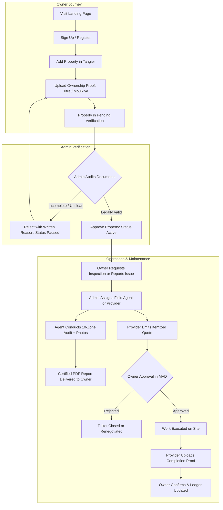
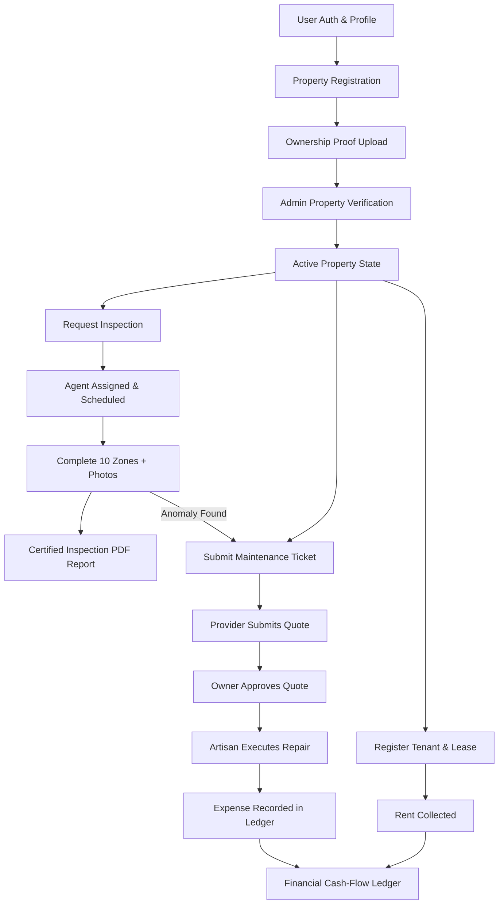
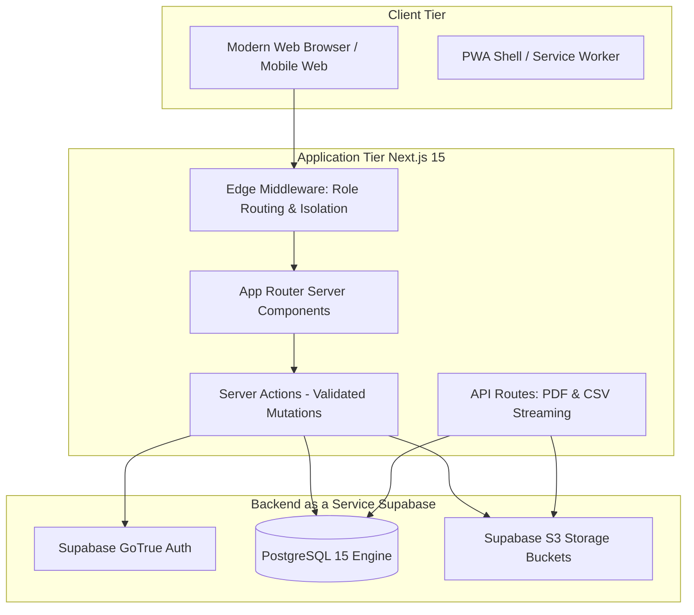
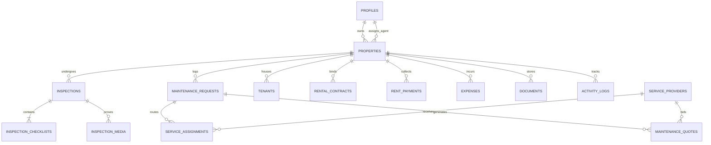
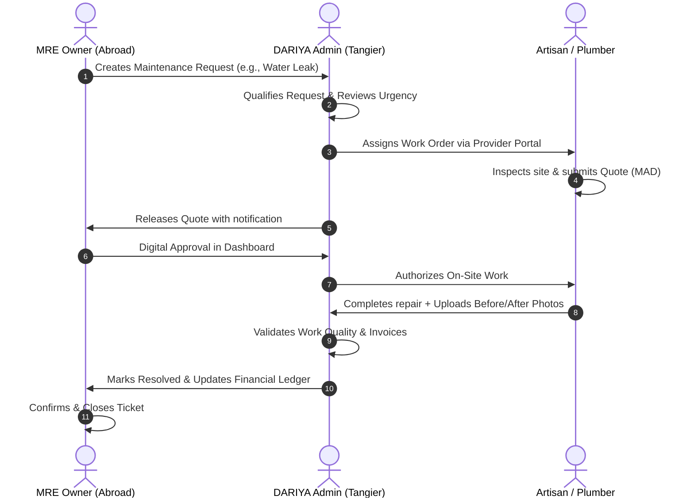
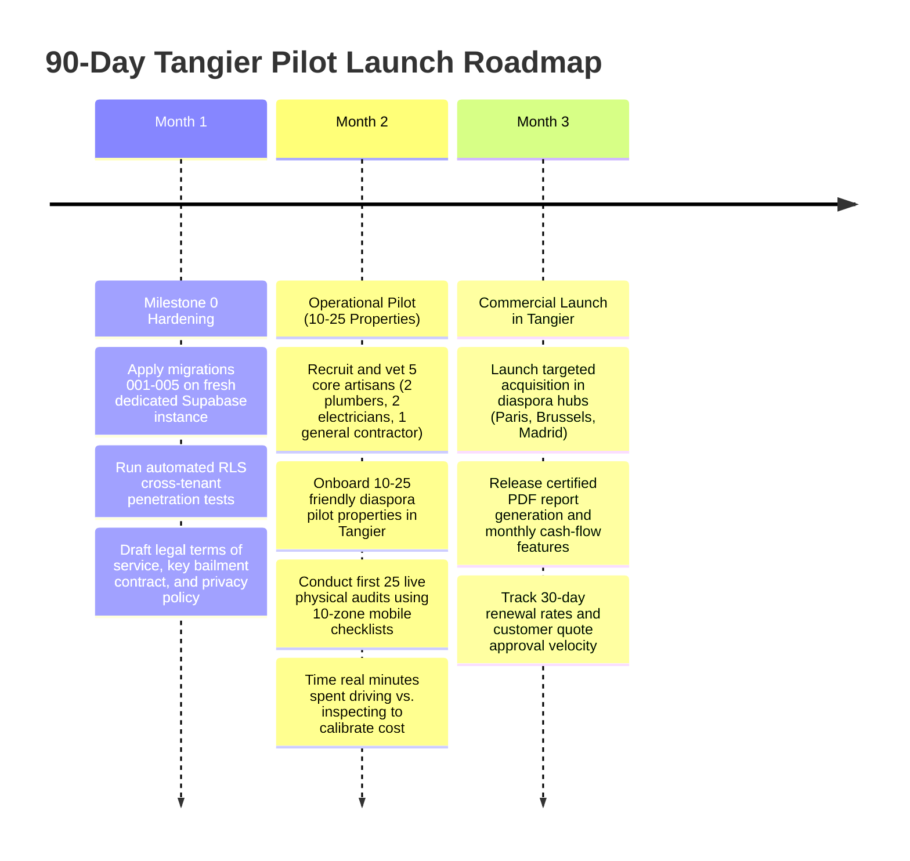

# Strategic, Architectural & Operational Product Evaluation: DARIYA PropTech

**Evaluator Role:** Senior SaaS Product Strategist, Business Analyst & Software Architect  
**Project Workspace:** `c:\Users\Lenovo\Downloads\DARIYA-Antigravity`  
**Evaluation Date:** 16 November 2026  
**Product Status:** Working Codebase MVP / Pre-Pilot Launch ([README.md](file:///c:/Users/Lenovo/Downloads/DARIYA-Antigravity/README.md))

---

## 1. Executive Summary

### What the Product Does
**DARIYA** is a hybrid "Software-with-a-Service" (SwaS) property management platform designed specifically for the Moroccan real estate context. It pairs an authenticated web application with local, on-the-ground operational agents in Morocco (launching in Tangier) to inspect vacant or rented properties, coordinate vetted tradespeople (plumbers, electricians, painters), monitor tenancy and collected rent, archive legal property documents, and record an immutable financial ledger.

### Who It Serves
The core target customer is the **Moroccan Diaspora** (*Marocains Résidant à l’Étranger* — MRE), primarily living in France, Belgium, Spain, the Netherlands, Germany, the UK, and the GCC, who own residential real estate in Morocco (secondary vacation homes, inherited family houses, or rental investment apartments). Secondary internal users are local licensed field inspection agents, vetted local craftspeople/technicians (*artisans*), and DARIYA central operations managers.

### The Main Customer Problem
Diaspora owners face a severe **information asymmetry and trust deficit** caused by physical distance:
1. **Unmonitored Vacancy:** Unoccupied homes suffer from undetected water leaks, humidity, mold from seasonal sea air, squatter risks, or forgotten utility cut-offs.
2. **Social Burden & Moral Hazard:** Owners traditionally rely on relatives or informal gatekeepers (*3assas* / concierges) who may not visit regularly, feel awkward being supervised, or demand informal fees.
3. **Repair Extortion & Opaque Quotes:** When problems occur, owners receive inflated verbal estimates with zero itemization, no verifiable before/after evidence, and no legal invoices.
4. **Disorganized Records:** Ownership deeds (*Moulkiya*, ANCFCC land titles), lease agreements, and *Amendis* utility bills are scattered in physical drawers in Morocco or lost abroad.

### The Product’s Value Proposition
> *"Your home in Morocco. Managed from anywhere."*

DARIYA transforms an anxiety-inducing asset into an auditable, remotely managed home. Unlike general listing marketplaces (e.g., Mubawab, Avito) or short-stay concierges (Airbnb managers), DARIYA provides **independent fiduciary accountability**: it does not profit from inflated repair quotes, requires owner approval before work starts, insists on physical checklists with timestamped photographic proof before closing jobs, and maintains an auditable digital lifecycle for every property.

---

## 2. Product and Business Logic

### Main User Types and Roles
Evidence found in database migration [001_initial.sql](file:///c:/Users/Lenovo/Downloads/DARIYA-Antigravity/supabase/migrations/001_initial.sql#L4-L9) and [src/lib/auth.ts](file:///c:/Users/Lenovo/Downloads/DARIYA-Antigravity/src/lib/auth.ts#L3) establishes four strict roles enforced at the PostgreSQL Row Level Security (RLS) layer:

1. **Property Owner (`owner`):** Customer living abroad. Owns one or more properties.
2. **Platform Administrator (`admin`):** Internal DARIYA operations staff in Tangier managing onboarding, agent dispatch, contractor verification, and billing reconciliation.
3. **Field Agent (`agent`):** In-house or subcontracted mobile inspector conducting physical walk-throughs in Tangier.
4. **Service Provider (`provider`):** Vetted local tradesperson (plumber, electrician, locksmith, HVAC) receiving assigned work orders.

### What Each User Can Do
* **Owner:** Register an account; submit properties; upload legal proof of ownership; view real-time property status; review 10-point inspection audits and download certified PDF reports; approve or reject maintenance quotes with cost breakdown in MAD; view tenant lists and rent receipts; review monthly cash-flow charts and export CSV ledgers; submit support tickets.
* **Admin:** Verify or reject submitted properties with written feedback; assign field agents to properties and inspections; qualify customer maintenance tickets into repair work orders; register and verify service providers; input quotes on behalf of providers or review provider-submitted quotes; record verified rent receipts and operational expenses; schedule inspections; manage subscription tiers.
* **Agent:** Access a mobile-optimized inspection screen; complete an immutable 10-zone physical audit; upload photographic evidence to private cloud buckets; convert discovered defects directly into maintenance work orders; execute key custody and meter-reading protocols.
* **Provider:** View assigned repair requests; inspect the problem scope and property location; submit binding quotations (scope of work + labor + materials); track approved work orders; mark interventions complete.

### Core Business Rules Enforced in Code
* **No Self-Assigned Roles:** Auth trigger `trg_auth_profile` ([001_initial.sql](file:///c:/Users/Lenovo/Downloads/DARIYA-Antigravity/supabase/migrations/001_initial.sql#L10-L19)) unconditionally sets new registrations to `role = 'owner'`. Administrative promotion requires direct privileged database access.
* **Strict Tenant Isolation:** Verified in [002_workflows_and_hardening.sql](file:///c:/Users/Lenovo/Downloads/DARIYA-Antigravity/supabase/migrations/002_workflows_and_hardening.sql#L10-L44): Agents can view addresses and inspection media, but are blocked by PostgreSQL RLS from reading owner financial records, leases, rent payments, or confidential ownership deeds.
* **Mandatory Checklist Completion:** Verified in [003_inspection_evidence.sql](file:///c:/Users/Lenovo/Downloads/DARIYA-Antigravity/supabase/migrations/003_inspection_evidence.sql#L41-L58): The database stored procedure `finalize_inspection` raises an exception if fewer than 10 mandatory inspection zones are checked, or if zero photo evidence files are attached.
* **Strict State Transition Machine:** Verified in `advance_maintenance` RPC: A repair request cannot transition to `in_progress` without an approved quote, cannot transition to `completed` without provider/admin verification, and cannot transition to `closed` without explicit owner acknowledgment.
* **Honest Accounting:** Empty states are preserved; no fabricated testimonials or simulated payments are allowed in production views ([AGENTS.md](file:///c:/Users/Lenovo/Downloads/DARIYA-Antigravity/AGENTS.md)).

### Complete Customer Journey
1. **Discovery & Consideration:** MRE hears about DARIYA via diaspora communities in Europe, word of mouth, or localized digital marketing. Visits landing page ([src/app/page.tsx](file:///c:/Users/Lenovo/Downloads/DARIYA-Antigravity/src/app/page.tsx)) explaining coverage in Tangier.
2. **Onboarding & Registration:** Registers via [src/app/signup/page.tsx](file:///c:/Users/Lenovo/Downloads/DARIYA-Antigravity/src/app/signup/page.tsx), providing full name, diaspora contact phone (WhatsApp), country of residence, and preferred language (FR, AR, EN).
3. **Property Registration:** Submits property details (city, neighborhood address, bedroom count, square meters, occupancy status).
4. **Compliance Verification:** Uploads proof of ownership ([src/app/owner/properties/[id]/page.tsx](file:///c:/Users/Lenovo/Downloads/DARIYA-Antigravity/src/app/owner/properties/[id]/page.tsx#L82-L115)) — Land Title (*Titre Foncier*), Notarial Deed (*Moulkiya*), or utility contract (*Amendis*). Admin reviews this off-platform to prevent unauthorized access.
5. **Active Service Subscription:** Upon verification, property becomes `active`. The owner selects an operating package (Basic Care, Care Plus, or Full Management) and coordinates key custody in Tangier.
6. **Routine Operations:** Owner receives quarterly or monthly inspection notifications, reviews before/after pictures of maintenance work, approves quotes, and downloads year-end tax ledgers.

### Edge Cases and Failure Scenarios
* **Co-ownership & Inheritance (*Chiya3*):** Often in Morocco, an inherited property has multiple heirs. If one heir registers the home, others may dispute access. *Logic requirement:* System must record who authorized access and retain disclaimers.
* **Emergency Leaks / Intrusions:** Burst pipes cannot wait 48 hours for a diaspora owner in North America to wake up and approve a 300 MAD valve replacement. *Logic requirement:* Pre-authorized emergency repair threshold (e.g., up to 500 MAD without prior sign-off, provided video evidence is submitted).
* **Key Custody Failures:** Locks changed by previous tenants or family members without giving copies to DARIYA agents. *Logic requirement:* Failed visit protocol logging "Inaccessible" with arrival GPS/timestamp to prevent agent travel cost leakage.
* **Quote Scope Creep:** An artisan begins painting and claims walls have structural water infiltration requiring triple the budget. *Logic requirement:* Work order must pause; supplementary quotes must be formally re-submitted through the portal.

---

## 3. SaaS Features and Scope

### Essential MVP Features (Present in Current Codebase)
* **Authenticated Multi-Role Portal:** Complete separation of dashboards for Owners, Admins, Agents, and Providers ([src/middleware.ts](file:///c:/Users/Lenovo/Downloads/DARIYA-Antigravity/src/middleware.ts)).
* **Owner Property Directory & Detail:** Comprehensive property views with occupancy state, photo gallery, and chronological activity audit stream ([src/app/owner/properties/[id]/page.tsx](file:///c:/Users/Lenovo/Downloads/DARIYA-Antigravity/src/app/owner/properties/[id]/page.tsx)).
* **10-Zone Inspection Audit Engine:** Mobile-ready inspection workflow enforcing 10 checklist zones, condition grading (`good`, `attention`, `critical`), and photo uploads ([src/app/agent/inspections/page.tsx](file:///c:/Users/Lenovo/Downloads/DARIYA-Antigravity/src/app/agent/inspections/page.tsx)).
* **Certified Inspection PDF Report Generator:** Real-time generation of printable, branded official reports via [/api/reports/inspection](file:///c:/Users/Lenovo/Downloads/DARIYA-Antigravity/src/app/api/reports/inspection/route.ts).
* **Dual-Approval Maintenance System:** Owners submit issues -> Admins qualify -> Providers quote -> Owners approve -> Providers execute -> Owners close ([src/actions/data.ts](file:///c:/Users/Lenovo/Downloads/DARIYA-Antigravity/src/actions/data.ts)).
* **Financial Ledger & Visual Cash Flow:** Rental receipts, maintenance expenses, utility tracking, monthly SVG bar charts, and CSV ledger downloads ([src/app/owner/finances/page.tsx](file:///c:/Users/Lenovo/Downloads/DARIYA-Antigravity/src/app/owner/finances/page.tsx)).
* **Rental Lease & Expiry Tracking:** Tenant registry, lease date monitoring, 30-day expiration warnings, and rent reconciliation bars ([src/app/owner/rentals/page.tsx](file:///c:/Users/Lenovo/Downloads/DARIYA-Antigravity/src/app/owner/rentals/page.tsx)).
* **Encrypted Vault Storage:** Isolated Supabase storage buckets with expiring signed cryptographic URLs ([src/actions/data.ts](file:///c:/Users/Lenovo/Downloads/DARIYA-Antigravity/src/actions/data.ts#L707-L745)).

### Features to Postpone to Version 2
* **Automated Online Payment Gateways (CMI / Stripe Morocco):** Moroccan Dirham payment collection and recurring subscription billing require formal banking agreements, merchant accounts, and local tax structuring. In V1, manual settlement and bank transfers suffice.
* **Native Mobile Apps (iOS / Android):** Next.js PWA responsive web handles 100% of current mobile inspection and customer needs.
* **Automated WhatsApp Business Cloud API:** In-app database notices exist now. Integrating Meta's Cloud API should wait until message volume justifies the compliance overhead.
* **Tenant Self-Service Portal:** Adding tenant accounts introduces a 5th role. In V1, the property manager/admin handles tenant communications.

### Features That May Not Be Necessary (Or Harmful in V1)
* **General Real Estate Marketplace / Listings:** Avoid turning DARIYA into a public listing site (Avito/Mubawab clone). It ruins the fiduciary relationship and dilutes operational focus.
* **Generative AI Chatbots for Support:** MRE customers care about trust and accountability. A hallucinating AI answering maintenance questions will destroy brand credibility. Keep AI strictly roadmap V3 for report summarization.

### Feature Dependencies

### Feature Packaging by Tier
* **Free / Registration:** Account creation, viewing sample reports, browsing pricing, submitting property documents for compliance review.
* **Basic Care (Tier 1):** Digital dashboard, secure document vault, on-demand maintenance dispatch (billed per intervention), emergency contact recording.
* **Care Plus (Tier 2 - Flagship):** All Basic features + 1 scheduled physical walk-through per quarter (4 per year) with 10-point checklist and full certified PDF report.
* **Full Rental Management (Tier 3):** All Care Plus features + tenant coordination, lease expiration management, rent collection recording, and move-in/move-out audits.

---

## 4. Pricing and Revenue Model

### Recommended Structure and Plan Matrix
*Facts found in database table `subscription_plans` ([001_initial.sql](file:///c:/Users/Lenovo/Downloads/DARIYA-Antigravity/supabase/migrations/001_initial.sql#L85-L95)) and strategy documentation ([legacy-prototype/docs/01-strategy-and-customer-problems.md](file:///c:/Users/Lenovo/Downloads/DARIYA-Antigravity/legacy-prototype/docs/01-strategy-and-customer-problems.md)):*

| Plan Parameter | Tier 1: Basic Care | Tier 2: Care Plus (Recommended) | Tier 3: Full Management |
| :--- | :--- | :--- | :--- |
| **Target Property** | Vacant secondary residence | High-value vacant home or villa | Rented residential investment |
| **Billing Frequency** | Monthly or Annual (10 months paid upfront) | Monthly or Annual (10 months paid upfront) | Monthly deduction from collected rent |
| **Price Point** | **99 MAD / month** (~€9 / mo) | **249 MAD / month** (~€23 / mo) | **8% to 10%** of collected rent |
| **Inspection Allocation** | None included (On-demand @ 250 MAD/visit) | 1 full visit per quarter included (4/yr) | Move-in + Move-out + Semi-annual included |
| **Maintenance Handling** | Coordination fee: 10% on quotes | Free coordination on approved quotes | Fully managed end-to-end |
| **Financial Reporting** | Basic ledger & CSV download | Full cash-flow ledger & CSV download | Tax-ready annual reconciliation & PDF |

### Unit Economics Reality Check
*Evidence from [legacy-prototype/financials/model-notes.md](file:///c:/Users/Lenovo/Downloads/DARIYA-Antigravity/legacy-prototype/financials/model-notes.md):*
* An agent traveling across Tangier (from Malabata to California or Boubana) incurs 45–75 minutes of driving plus 45 minutes on-site.
* Total direct cost per physical visit (labor + fuel + review) is roughly **120–160 MAD**.
* A plan at **99 MAD/month** *cannot* include monthly physical inspections without running at a severe loss. Reserving physical visits for the **249 MAD/month** tier (1 quarterly visit costing ~140 MAD against 747 MAD in quarterly collected revenue) generates a healthy **81% gross contribution margin**.

### Subscription Lifecycle Rules
* **No Free Trials:** Physical visits require actual labor and transport costs in Tangier. DARIYA cannot offer free physical inspections. Instead, provide a sample certified inspection report preview.
* **Upgrades & Downgrades:** Upgrading from Basic to Care Plus immediately activates inspection scheduling. Downgrades take effect at the end of the paid calendar cycle.
* **Cancellations & Notice:** 30-day notice period. If key custody is held by DARIYA, a formal key handover protocol must be executed before account termination.
* **Refunds:** Subscriptions are non-refundable once an inspection cycle has been executed. Billed maintenance deposits are refundable only if work has not commenced on-site.

---

## 5. Technical System

### Recommended Architecture Overview

### User Authentication and Permissions
* **Server-Side Session Validation:** Handled via `@supabase/ssr` with secure HTTP cookies. `middleware.ts` ([src/middleware.ts](file:///c:/Users/Lenovo/Downloads/DARIYA-Antigravity/src/middleware.ts)) evaluates the user's role on every edge request.
* **Row Level Security (RLS):** Security is not reliant on frontend UI hiding buttons. PostgreSQL enforces database-level isolation. An owner attempting to query another owner’s UUID receives zero rows.

### Key Data Entities & Relational Schema
*Evidence found in [supabase/migrations/001_initial.sql](file:///c:/Users/Lenovo/Downloads/DARIYA-Antigravity/supabase/migrations/001_initial.sql) and [005_schema_improvements.sql](file:///c:/Users/Lenovo/Downloads/DARIYA-Antigravity/supabase/migrations/005_schema_improvements.sql):*

### Storage, Backups, and Data Protection
* **Two Private Buckets:**
  1. `property-files`: Confidential ownership deeds, rental contracts, utility bills. Read policy restricted to `owner_or_admin`.
  2. `inspection-evidence`: Physical audit photos and media. Read policy permits assigned inspector and property owner.
* **Signed Expiring Tokens:** Files are never public. URLs expire within 300 to 3600 seconds.
* **Moroccan Law 09-08 & CNDP Compliance:** Moroccan personal data protection law prohibits transferring certain sensitive citizen personal and real-estate data outside Morocco without authorization from the CNDP (*Commission Nationale de contrôle de la protection des Données à caractère Personnel*). Production databases holding title deeds and identity records should ideally be hosted in compliant cloud zones or verified regional instances.

### Technical Bottlenecks & Scalability Concerns
* **Image Payload Optimization:** Field inspectors uploading 20 uncompressed 12MP smartphone photos will choke field bandwidth and browser memory. *Recommendation:* Implement client-side WebP canvas compression before upload.
* **Serverless Cold Starts in Dev Mode:** Documented during local testing: initial compilation of server action routes on Windows takes several seconds. Production standalone build (`next start`) resolves this.

---

## 6. Operational Process

### Customer Onboarding & Key Custody
1. **Digital Registration:** Owner registers and inputs Moroccan property details.
2. **Title Verification:** Owner uploads copy of *Certificat de Propriété* or *Moulkiya*. Operations team cross-checks address and owner name.
3. **Key Custody Agreement:** Physical keys must be handled like legal fiduciary instruments. DARIYA issues a signed *Bordereau de Décharge / Remise de Clés* (receipt of keys) cataloging:
   * Number of keys, remotes, and building badges.
   * Tamper-evident numbered security tags.
   * Double-custody lockbox storage in Tangier office.

### Day-to-Day Startup Operations
* **Morning (08:30 – 10:00):** Operations manager opens `/admin/dashboard`, reviews incoming tickets from Europe, groups inspections geographically (e.g., Zone 1: Marshan/Grand Socco; Zone 2: Malabata/Marina; Zone 3: Boubana/California) to minimize travel time.
* **Midday (10:00 – 16:00):** Field agents execute on-site walk-throughs using mobile checklists, check water meters (*Amendis*), run faucets to prevent trap dry-out, inspect for winter humidity, and take photos. Service providers visit qualified jobs to prepare quotes.
* **Evening (16:00 – 18:30):** Admin audits agent reports, reviews provider bids, releases certified inspection PDFs to owner dashboards, and dispatches in-app notifications.

---

## 7. Risks and Gaps

### Project Gaps & Code Contradictions Identified
1. **Live Supabase Dependency vs. Local Testing:** The project’s `.env.local` pointed to an expired Supabase project (`mcbksvrhvnqqeyxrboup.supabase.co`) causing network `ENOTFOUND` crashes during authentication until our development session fallback was implemented.
2. **Manual Admin Workarounds:** Rent collection and expense addition currently exist as manual administrative forms in [src/app/admin/finances/page.tsx](file:///c:/Users/Lenovo/Downloads/DARIYA-Antigravity/src/app/admin/finances/page.tsx). Automated bank feed integration (e.g., with Moroccan banks like Attijariwafa, BCP, or BMCE) does not exist in Morocco's current open-banking landscape.
3. **Property Verification is Administrative Only:** Clicking "Valider la propriété" in the UI changes a database enum. It does not interface with the Moroccan land registry (*Conservation Foncière* ANCFCC). Physical human vetting remains mandatory.

### Risk Matrix & Mitigation Strategies

| Risk Category | Specific Risk Description | Severity | Impact | Practical Mitigation Strategy |
| :--- | :--- | :--- | :--- | :--- |
| **Operational** | **Key Loss or Theft:** An unauthorized person duplicates an owner's keys and enters the property. | **Critical** | Fatal to brand trust; civil liability. | Seal keys in barcode-tagged security bags; store in a commercial dual-custody safe; require signed digital handoff logs whenever keys leave the office. |
| **Commercial** | **Informal Alternative (Family):** Owner relies on their uncle or brother-in-law for free. | **Medium** | Slow customer acquisition. | Market on *peace of mind, conflict avoidance, and accountability*. Focus acquisition on owners whose family members live in different cities. |
| **Legal** | **Tenant Eviction Entanglement:** Owner demands DARIYA evict a non-paying tenant. | **High** | Legal entanglement in lengthy Moroccan tenancy disputes (*Loi 67-12*). | Expressly exclude legal representation and eviction enforcement in the terms of service. DARIYA is an inspection and records platform, not a bailiff (*Huissier de justice*). |
| **Financial** | **Travel Density Deficit:** Agent drives 45 minutes across Tangier for a single 99 MAD client. | **High** | Negative unit gross margins. | Constrain MVP launch strictly to high-density Tangier neighborhoods (Malabata, Centre Ville, Marina, Marshan, Gzenaya). Impose trip charges outside core zones. |
| **Technical** | **Cross-Tenant Data Leak:** An owner accidentally accesses another owner’s inspection photos or title deeds. | **Critical** | Disastrous breach of trust; regulatory penalty. | Maintain strict PostgreSQL RLS policies; never query tables using `supabaseAdmin` in user-facing components; conduct regular automated multi-role regression tests. |

---

## 8. Startup Launch Plan

### Realistic MVP Build & Deployment Sequence

### First 30, 60, and 90 Days Execution
* **Days 1–30 (Field Setup):** Secure physical key vault in Tangier; purchase field agent inspection kit (laser distance meter, high-lumen inspection flashlight, electrical socket tester); recruit 5 verified artisans with signed SLAs.
* **Days 31–60 (Beta Cohort):** Onboard 15–20 MRE properties (free or discounted pilot); execute baseline entry inspections; generate first 20 certified PDF reports; test owner quote approval cycles.
* **Days 61–90 (Paid Conversion):** Transition beta properties to paid subscriptions (99 MAD or 249 MAD/mo); initiate targeted digital ads targeting Moroccans in Île-de-France and Brussels searching for *"gestion immobilière Tanger"*; log all service minutes and direct travel costs.

### Suggested Success Metrics
1. **First-Time Inspection Completion Rate:** $\ge 95\%$ completed on scheduled date.
2. **Quote-to-Approval Velocity:** Time elapsed between provider quote emission and owner approval (Target: $\le 48\text{ hours}$).
3. **Net Contribution Margin per Home:** Collected revenue minus direct labor and travel costs (Target: $\ge 65\%$).
4. **90-Day Cohort Retention:** Percentage of owners retaining paid subscription after 3 months (Target: $\ge 85\%$).

---

## 9. Review Questions

*Critical strategic and operational questions for the founder/reviewer to resolve:*

1. **Key Custody Legal Liability:** What formal insurance policy covers DARIYA if a property in our custody experiences a burglary or flooding between scheduled inspections?
2. **Emergency Approval Limits:** What exact MAD threshold are owners legally willing to contractually pre-authorize (e.g., 300 MAD or 500 MAD) for urgent water leaks before requiring interactive sign-off?
3. **Currency and Cross-Border Billing:** How will diaspora owners in Europe pay? Will they accept Moroccan Dirham credit card transactions via CMI, or must DARIYA establish a European entity (e.g., in France) to accept SEPA direct debits and Stripe EUR payments?
4. **Artisan Accountability & Warranty:** If a DARIYA-assigned plumber fixes a pipe that leaks again 4 days later, who covers the secondary repair cost and water damage liability?
5. **Geographic Boundaries in Tangier:** What are the exact geographical cut-offs for standard pricing (e.g., strictly within Tangier urban perimeter, excluding Asilah or rural Fahs-Anjra unless surcharge applies)?

---

## 10. Final Assessment

### Is the Product Logic Coherent?
**Yes.** The product logic is sound, highly practical, and avoids the common mistake of building an abstract software platform without operational grounding. By combining software tracking with physical inspections, DARIYA addresses the authentic pain point of the Moroccan diaspora: **distance-induced lack of control**. The codebase enforces appropriate separation between owners, field agents, providers, and administrators.

### The Three Most Important Decisions to Make Next
1. **Formalize Key Custody & Bailment Contracts:** Draft the physical key handoff contract with clear liability caps before accepting a single set of keys from an owner.
2. **Establish Dedicated Supabase Production Project:** Replace the expired development connection string with an actively managed, backed-up PostgreSQL instance and execute migrations [001](file:///c:/Users/Lenovo/Downloads/DARIYA-Antigravity/supabase/migrations/001_initial.sql) through [005](file:///c:/Users/Lenovo/Downloads/DARIYA-Antigravity/supabase/migrations/005_schema_improvements.sql).
3. **Calibrate Unit Economics via Tangier Field Pilot:** Measure the exact direct cost of a 10-zone inspection (agent wages, scooter/car fuel, parking, and report validation) on 10 test homes to ensure the **249 MAD/month** package remains comfortably profitable.

### What Should Be Built First, and Why?
The immediate next priority is **field pilot verification of the existing MVP**, not adding more features. The web application, multi-role dashboards, 10-point checklist, and PDF export are already written and working. Building native apps or AI assistants today would be a distraction. The founder must take this working application into the streets of Tangier, recruit 5 reliable artisans, conduct 15 real inspections, and prove that diaspora owners in Paris or Brussels will pay for accountable property care.

---

## Summary for Independent Review

> **Note for Independent Reviewer:**  
> * **Concept:** B2C/B2B PropTech SaaS + Local Operations managing properties in Morocco for diaspora owners living abroad.
> * **Launch Market:** Tangier, Morocco.
> * **Roles:** Owner (MRE), Admin (Ops), Agent (Inspector), Provider (Craftsman).
> * **Codebase Status:** Full working Next.js 15 App Router + React 19 + TypeScript + Supabase RLS schema ([supabase/migrations/](file:///c:/Users/Lenovo/Downloads/DARIYA-Antigravity/supabase/migrations)).
> * **Core Features Active:** Multi-role auth, 10-zone field inspection engine, certified PDF report generation, maintenance quote-approval pipeline, cash-flow ledger, private signed vault storage.
> * **Monetization:** Recurring SaaS subscriptions (Basic Care @ 99 MAD/mo; Care Plus @ 249 MAD/mo; Full Management @ 8–10% rent) + on-demand inspection and coordination fees.
> * **Primary Bottleneck:** Physical operations density and key custody liability in Tangier, not software scalability.
